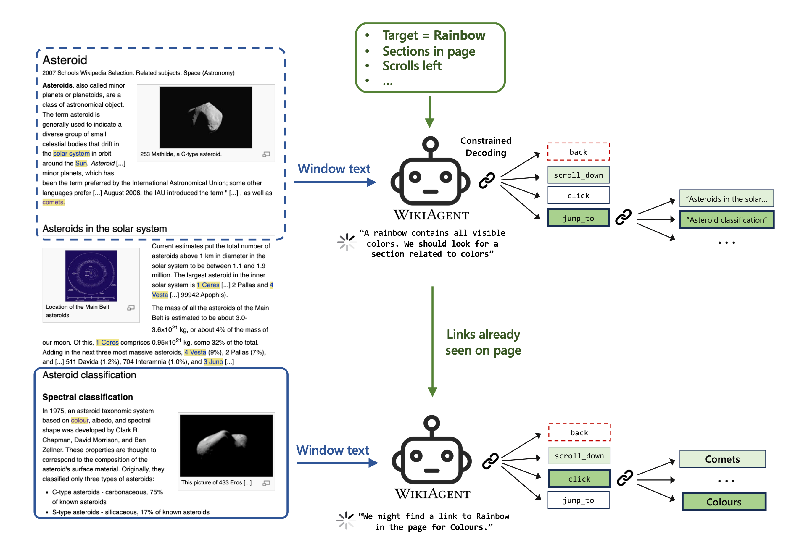

# WikiAgent
LLM-powered agent for human-like targeted Wikipedia navigation.



## Reproducibility
For DLAB users, we recommend performing the following steps in ICCluster, in the `/dlabdata1/<your-username>` directory, as it is accessible from RunAI pods.

### Initial setup and data
- Clone this repo, and create an environment with the packages in `requirements.txt`.
- Download the data from [here](https://www.dropbox.com/scl/fi/gzqjkf2x9tgtr1gtv10ud/data_archived.zip?rlkey=gkmi4i3014cpyppbtqu5mkt1h&dl=0). Unzip the files and place them in the `data` directory. This data consists of the `wikispeedia` (embeddings, wikispeedia missions, etc.) and `wpcd` (Wikipedia articles) folders.

### Prepare the config
We use the `hydra-core` library to manage configurations of agents, models, experiments, etc., in the `src/configs` directory. 
- In `src/configs/config.yaml` is the main config file. Change the directories based on your setup. For DLAB users, you can just change your username in `workdir`.

### Quick start
The following command runs a single experiment with the ReAct constrained WikiAgent on 100 missions sampled randomly from the Wikispeedia user missions. The main output of this experiment will be the file with all the agent actions in `logs/multiruns/test_run/0/agent_runs.tsv`.

```bash
python src/run.py --multirun model.batch_size=2\
    experiment=random \
    model=mistral_7b_instruct_v0.2 \
    agent=navigate/lmql_headings_reason \
    experiment.num_agents=100 \
    +agent.verbose=True \
    run_name="test_run"
```
Here's the breakdown of the command:
- `python src/run.py`: run the main file.
- `--multirun`: Hydra command for running multiple experiments in a row. In this case, we are running a single experiment.
- `model.batch_size=2`: The batch size of the model.
- `experiment=random`: The experiment to run, defined in `src/configs/experiment`. 
    - `random`: randomly samples unique missions from the Wikispeedia user missions.
    - `human_test_set`: samples missions that have been played at least 4 times by humans.
- `model=mistral_7b_instruct_v0.2`: The model to use, defined in `src/configs/model`. To create a new model, copy one of the existing model files and change the parameters.
- `agent=navigate/lmql_headings_reason`: Agent type, defined in `src/configs/agent`.
    -  `navigate` -> WikiAgent; `link_click` -> links-only WikiAgent.
    - `lmql`-> constrained decoding.
    - `reason` -> reasoning before action (ReAct).
- `experiment.num_agents=100`: The number of missions to run.
- `+agent.verbose=True`: Print the prompt at each step.
- `run_name="test_run"`: The name of the run. The logs are saved in `logs/multiruns/<run_name>`.

Any other parameter can be changed in the command line. If the parameter is not specified in the `yaml` files (for agent, model, etc.), it can still be changed by adding a `+` before the parameter name.

### Experiments
All scripts for the experiments are in the `scripts` directory. Before running them, make sure to change the folders to your setup. The naming convention for the experiments is mostly `<mission-sample>_<agent-type>_<index>.sh`. The `<index>` is used to split the same experiment into multiple parallel scripts.

For the `<mission-sample>`:
- `random`: randomly sampled unique missions from the Wikispeedia user missions.
- `human`: samples missions that have been played at least 4 times by humans.
- `click`: for click comparison experiments.

For the `<agent-type>`:
- `link`: links-only WikiAgent.
- `nav`: WikiAgent.

