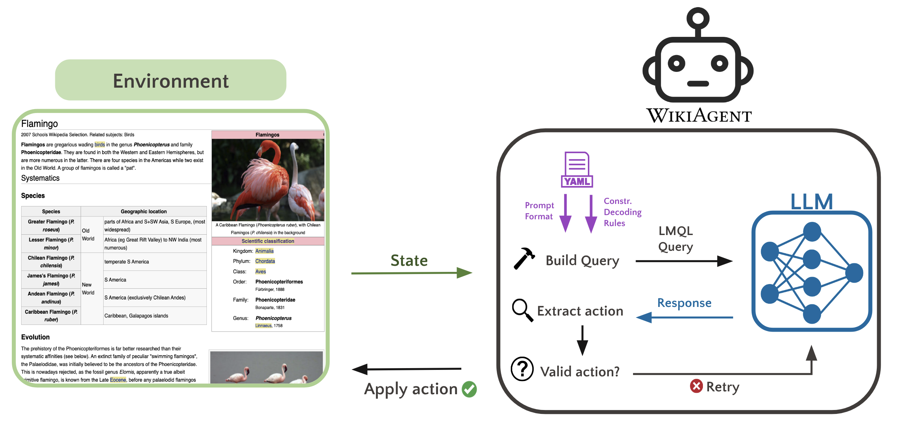

<div alig="center">
  <center><h1>WikiAgent: LLM-powered agent for targeted Wikipedia navigation</h1></center>
</div>


# Overview


🤖 **WikiAgent**: a language model-powered agent that navigates Wikipedia pages to reach a target page.

🔍 **Open-Source Focused**: Specifically designed for open-source LLMs, WikiAgent is compatible with any HuggingFace instruction LLM. 

🚀 **Small Yet Mighty**: WikiAgent features grounded action generation with **constrained decoding**, using [LMQL](https://github.com/eth-sri/lmql). We empower smaller LLMs, like Mistral 7B, to outperform large closed-source models like ChatGPT.

# LLM-Agent-Environment interaction



The main goal of this framework is to facilitate the development of agents with varying capabilities in a modular and easy-to-experiment way. The interface for LLM interaction is handled by LMQL, allowing easy model serving, asynchronous batching, and automatic redistribution of LLM responses among agents. Our framework is compatible with any chat fine-tuned model from HuggingFace, and the changes necessary to account for other models ([llama.cpp](https://github.com/ggerganov/llama.cpp) or OpenAI API) are minimal. We also implement an abstract `Environment` class, which serves mainly as a barebones base from which to build the main environment for Wikipedia page navigation environment.

## Agent
The `Agent` class is designed for constrained decoding and extensibility, allowing easy creation of specific agent subclasses. Each agent type is configured through a `config.yaml` file, which allows customization of prompt structure, maximum actions, and constrained decoding rules (LMQL query). This flexibility facilitates experimentation and testing, using the 
[Hydra](https://pypi.org/project/hydra-core/) package for agent instantiation.

Key methods and subroutines in the `Agent` class include:

- **`build_prompt`**: Constructs the prompt based on the `config.yaml` file. It observes the environment, integrates state variables into the last user message, and outputs a chat log formatted as a list of dictionaries (`{"role": [role], "content": [text content]}`).

- **`prepare_chat`**: Converts the message list from `build_prompt` into a text block, adapting to different LLM chat templates. Outputs a string for model input.

- **`get_query`**: Processes the text prompt, handling special characters sensitive to LMQL, and constructs the LMQL query using the `config.yaml` template. Outputs an LMQL query object.

- **`send_query`**: Implemented in child classes, this method passes variables (actions, clickable links, etc.) to the LMQL query, facilitating constrained LLM decoding. It supports asynchronous LLM querying and batching in the LMQL backend. Outputs an LMQL result object.

- **`extract_actions` and `apply_actions`**: Extracts and validates actions from the LMQL result against the available actions list. Applies actions through the `Environment` class, handling exceptions as feedback for model correction in subsequent prompts.

## Environment
The `TextWikiEnvironment` class is designed to handle the Wikipedia page navigation environment, providing a simple interface for agent interaction. It uses a `NavigatorHTML` object to convert HTML to text and to simulate a scrolling window. It also saves information throughout a game, such as the window positions as WikiAgent leaves a page, the visited pages, and the visited sections. This allows for easy logging of games, and is also required for the backtracking action.

The environment object provides the current state to WikiAgent, comprising the following variables:

- **Previous Page**: The last page visited in the path, or `None` if the current page is the source.
- **Current and Target Pages**: The currently viewed page and the target page of the mission.
- **Clickable Links**: All navigable links on the current page, excluding links to previously visited pages.
- **Page Sections**: Sections of the current page (`h2` and `h3` HTML headings), omitting sections already visited.
- **Window Text**: The visible text in a 500-token window (based on the agent's LLM tokenizer). This window moves down with each scroll and jumps to the start of a section upon selecting the `jump_to` action.
- **Remaining Scrolls**: The number of scrolls left before reaching the page's end.


# Reproducibility
For DLAB users, we recommend performing the following steps in ICCluster, in the `/dlabdata1/<your-username>` directory, as it is accessible from RunAI pods.

## Initial setup and data
- Clone this repo, and create an environment with the packages in `requirements.txt`.
- Download the data from [here](https://www.dropbox.com/scl/fi/gzqjkf2x9tgtr1gtv10ud/data_archived.zip?rlkey=gkmi4i3014cpyppbtqu5mkt1h&dl=0). Unzip the files and place them in the `data` directory. This data consists of the `wikispeedia` (embeddings, wikispeedia missions, etc.) and `wpcd` (Wikipedia articles) folders.

## Prepare the config
We use the `hydra-core` library to manage configurations of agents, models, experiments, etc., in the `src/configs` directory. 
- In `src/configs/config.yaml` is the main config file. Change the directories based on your setup. For DLAB users, you can just change your username in `workdir`.

## Quick start
The following command runs a single experiment with the ReAct constrained WikiAgent on 100 missions sampled randomly from the Wikispeedia user missions. The main output of this experiment will be the file with all the agent actions in `logs/inference/multiruns/test_run/0/agent_runs.tsv`.

```bash
python src/run.py --multirun model.batch_size=2\
    experiment=random \
    model=mistral_7b_instruct_v0.2 \
    agent=navigate/lmql_headings_reason \
    experiment.num_agents=100 \
    +agent.verbose=True \
    run_name="test_run"
```
Here's the breakdown of the command:
- `python src/run.py`: run the main file.
- `--multirun`: Hydra command for running multiple experiments in a row. In this case, we are running a single experiment.
- `model.batch_size=2`: The batch size of the model.
- `experiment=random`: The experiment to run, defined in `src/configs/experiment`. 
    - `random`: randomly samples unique missions from the Wikispeedia user missions.
    - `human_test_set`: samples missions that have been played at least 4 times by humans.
- `model=mistral_7b_instruct_v0.2`: The model to use, defined in `src/configs/model`. To create a new model, copy one of the existing model files and change the parameters.
- `agent=navigate/lmql_headings_reason`: Agent type, defined in `src/configs/agent`.
    -  `navigate` -> WikiAgent; `link_click` -> links-only WikiAgent.
    - `lmql`-> constrained decoding.
    - `reason` -> reasoning before action (ReAct).
- `experiment.num_agents=100`: The number of missions to run.
- `+agent.verbose=True`: Print the prompt at each step.
- `run_name="test_run"`: The name of the run. The logs are saved in `logs//inference/multiruns/<run_name>`.

Any other parameter can be changed in the command line. If the parameter is not specified in the `yaml` files (for agent, model, etc.), it can still be changed by adding a `+` before the parameter name.

## Experiments
All scripts for the experiments are in the `scripts` directory. Before running them, make sure to change the folders to your setup. The naming convention for the experiments is mostly `<mission-sample>_<agent-type>_<index>.sh`. The `<index>` is used to split the same experiment into multiple parallel scripts.

For the `<mission-sample>`:
- `random`: randomly sampled unique missions from the Wikispeedia user missions.
- `human`: samples missions that have been played at least 4 times by humans.
- `click`: for click comparison experiments.

For the `<agent-type>`:
- `link`: links-only WikiAgent.
- `nav`: WikiAgent.

